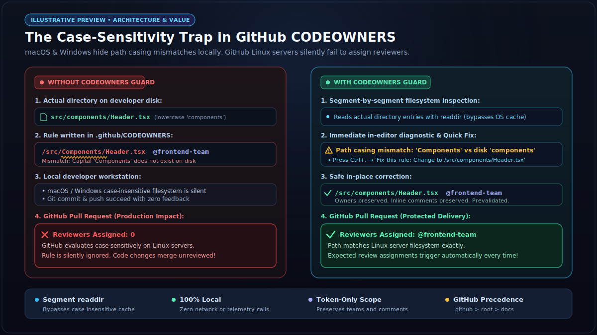
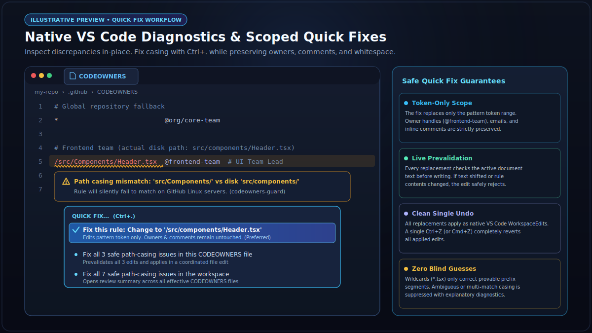
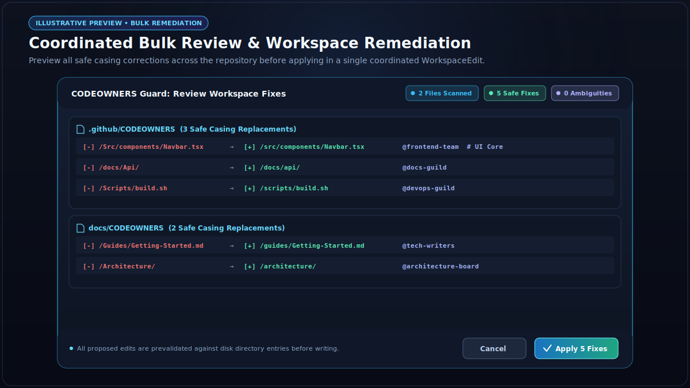

# CODEOWNERS Guard

A local-only, production-grade VS Code extension that catches GitHub `CODEOWNERS` path casing and syntax issues using filesystem-aware directory inspection and safe, scoped Quick Fixes.

---

## Why CODEOWNERS Guard?

GitHub evaluates `CODEOWNERS` path patterns with case-sensitivity on its Linux servers. If your repository has a directory named `src/components/`, but your `CODEOWNERS` file specifies:

```codeowners
/src/Components/ @org/frontend-team
```

GitHub's code review assignment will silently fail to match changes in `src/components/`. On developer machines running macOS or Windows (which often use case-insensitive filesystems by default), this mismatch is invisible during local testing.

**CODEOWNERS Guard** inspects the literal directory entries on your filesystem, detects discrepancies before you commit, and offers safe, scoped Quick Fixes directly inside VS Code.


*Illustrative preview: How CODEOWNERS Guard detects case-sensitivity discrepancies on local filesystems before changes reach GitHub.*

---

## Key Features & Primary Workflow

The extension operates with a zero-friction interaction model:

**Automatic detection → Native diagnostics → `Ctrl+.` → Scoped Quick Fixes → Command Palette fallback**

### 1. Automatic, Non-Blocking Scanning
- **On activation**: Automatically discovers repository roots and effective `CODEOWNERS` files.
- **On file open / save**: Immediately scans and populates VS Code native diagnostics.
- **On live edit**: Debounced (300ms) background analysis ensures instantaneous feedback without lag or file locking.
- **On filesystem changes**: Detects file creation, renaming, and deletion, invalidates directory caches, and rescans relevant files.

### 2. Three Scopes on `Ctrl+.`
When hovering or positioning your cursor on a path casing finding, pressing `Ctrl+.` (or `Cmd+.` on macOS) provides three clearly scoped actions:

1. **Fix this rule** *(Preferred Quick Fix)*:
   - Edits only the pattern token range.
   - Preserves owner lists, whitespace, inline comments, and surrounding formatting.
   - Performs live prevalidation against document contents to reject stale ranges.

   
   *Illustrative preview: Native in-editor warning diagnostic and scoped Quick Fix options accessed via Ctrl+.*

2. **Fix all N safe path-casing issues in this CODEOWNERS file**:
   - Shows a native review modal summarizing the fix count.
   - Prevalidates every edit before applying.
   - Applies all replacements in a single coordinated `WorkspaceEdit`.
3. **Fix all M safe path-casing issues in the workspace**:
   - Gathers safe casing fixes across all effective `CODEOWNERS` files across all workspace folders.
   - Shows a review summary with affected file paths and total fix counts.
   - All edits are prevalidated and applied as a coordinated WorkspaceEdit. If prevalidation fails or the user cancels, no edits are applied.

   
   *Illustrative preview: Coordinated bulk review across multiple CODEOWNERS files with coordinated WorkspaceEdit application with prevalidation and cancellation safety.*

All fixes preserve standard VS Code undo (`Ctrl+Z`).

---

## GitHub Precedence & Discovery

In accordance with official GitHub documentation, CODEOWNERS Guard discovers and respects the precedence of `CODEOWNERS` locations:

1. `.github/CODEOWNERS` (Highest precedence)
2. `CODEOWNERS` (Repository root)
3. `docs/CODEOWNERS` (Lowest precedence)

The first existing file in that order is designated as the **effective** file. If lower-precedence files exist, CODEOWNERS Guard flags them with an informational diagnostic explaining that a higher-precedence file is active.

### Repository Root vs Workspace Root
The extension does not assume that every VS Code workspace root is a Git repository root. It inspects parent directories upward for a `.git` directory or worktree `.git` file, resolving paths relative to the true repository root while gracefully falling back to the workspace folder when no repository marker is present. Multi-root workspaces are supported with independent repository boundary resolution.

---

## Conservative Pattern Semantics

CODEOWNERS Guard aims to prevent false positives and unsafe replacements:

- **Segment-by-Segment Literal Inspection**: Reads actual directory entries via `readdir`. Does not rely solely on `existsSync` or `statSync`, ensuring that case-insensitive filesystems do not mask wrong-cased paths.
- **Wildcards with Provable Prefixes**: For wildcard rules like `/Src/components/*.tsx`, the extension only validates and corrects the provable literal directory prefix (`/src/components/*.tsx`), never guessing wildcard segments.
- **Ambiguity Suppression**: If multiple entries match on a case-sensitive filesystem (e.g. `src/test/` and `src/Test/`), automatic correction is suppressed with an explanatory warning.
- **Unmatched Literal Paths**: Fully literal paths that do not exist on disk are diagnosed with a warning, but never receive a fabricated or guessed Quick Fix.
- **Unsupported GitHub Syntax**: GitHub CODEOWNERS does not support `!` negation or `[ ]` character ranges (unlike gitignore). Lines using this syntax are flagged with an informational diagnostic.
- **Duplicate Rules**: Earlier duplicate rules overridden by later matching rules are diagnosed to explain GitHub's "last matching rule wins" rule.

---

## Configuration

You can customize path exclusions in your VS Code settings:

```json
{
  "codeownersGuard.exclude": [
    "**/.git",
    "**/node_modules",
    "**/dist",
    "**/build",
    "**/coverage"
  ]
}
```

Directories matching these patterns are pruned during workspace scans and ignored during path resolution.

---

## Fallback Commands

Automatic scanning and `Ctrl+.` are the primary workflow. However, manual fallback commands are available in the Command Palette:

- `CODEOWNERS Guard: Scan Current File` (`codeowners-guard.scanCurrentFile`)
- `CODEOWNERS Guard: Scan Workspace` (`codeowners-guard.scanWorkspace`)
- `CODEOWNERS Guard: Fix All in Current File` (`codeowners-guard.fixAllInFile`)
- `CODEOWNERS Guard: Fix All in Workspace` (`codeowners-guard.fixAllInWorkspace`)

---

## Safety, Privacy & Limitations

- **100% Local & Offline**: No AI, no telemetries, no backend services, no network calls, and no GitHub API calls.
- **No Automatic File Edits**: The extension will never modify your files on open, scan, edit, or save. All edits require explicit user confirmation.
- **3 MB File Size Limit**: In line with GitHub's CODEOWNERS file limit, files larger than 3 MB are skipped with an informational diagnostic.
- **Owner Verification Limitation**: CODEOWNERS Guard validates paths on the local filesystem. It does not verify whether GitHub usernames, teams, or emails exist or have write permissions. Ownerless rules are permitted as valid.
- **Parser Scope**: Focuses on GitHub CODEOWNERS semantics and safe path casing. It is not an arbitrary server-side gitignore or git-attribute engine.

---

## License

MIT License. Copyright (c) 2026 ajkaarthick.
